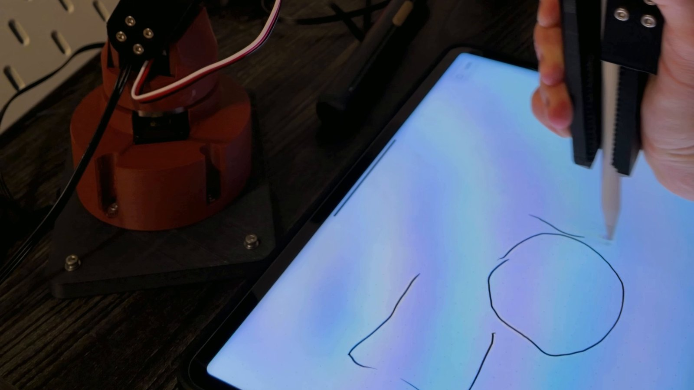

# Bitzy Lite

### A light 3D-printed robot arm you teach by hand

**Harrison B. Goldberg / October 2026 - Present**

Built and in progress. A lighter follow-up to Bitzy V1: five axes and a gripper on six Feetech STS3215 serial-bus servos, with printed links and a PETG-CF base plate. Assembled October 19, 2026. On October 26, 2026 it was guided by hand through a stick-figure drawing on a tablet, the screen was cleared, and it redrew the figure on its own (teach and repeat). Link lengths and reach are from the CAD model. Replay accuracy, repeatability, payload and speed are not measured.

AI-assisted workflows supported the creation of this project. My Python work is carried out entirely through AI-assisted workflows using Claude Code and Codex.

## Explore

| File | Contents |
|---|---|
| [Public page](index.html) | Teach-and-repeat video, why, design, build and next steps |
| [media/](media/) | Photos and silent videos (metadata stripped) |

## Release boundary

Public documentation only. Editable CAD, print files and control software remain private. [Rights and use](RIGHTS.md).
