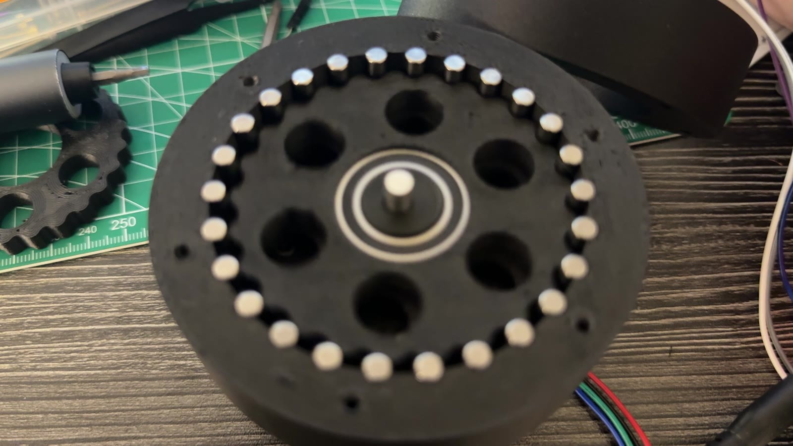

# Cycloid R1

### 25:1 3D-printed cycloidal gearbox and its evolution from a planetary drive

**Harrison B. Goldberg / September 2026 - Present**

Built and bench-tested without load. A NEMA17-driven 25:1 cycloidal reducer, printed in PETG-CF. It evolved from the G9 9:1 planetary and the 9.97:1 double-helical Gearbox V2. Measured: 25.00:1 ratio, 1.3′ same-direction repeatability, no lost steps from 10 to 150 °/s, and open-loop lost motion of 71′ (first discs) and 57′ (R2 discs), which fell to about 2′ with closed loop on the output encoder. Torque, stiffness, efficiency and wear are not measured.

AI-assisted workflows supported the creation of this project. My Python work is carried out entirely through AI-assisted workflows using Claude Code and Codex.

## Explore

| File | Contents |
|---|---|
| [Public page](index.html) | Videos, evolution, design, measurements, control and status |
| [media/](media/) | CAD renders, bench charts and silent videos (metadata stripped) |

## Release boundary

Public documentation only. Editable CAD, print files, firmware, bench software and raw logs remain private. [Rights and use](RIGHTS.md).
